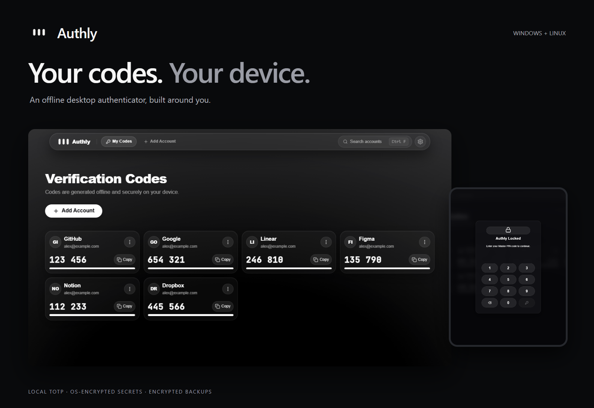
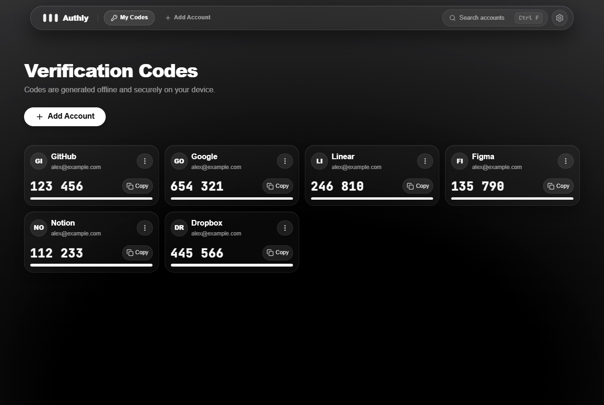
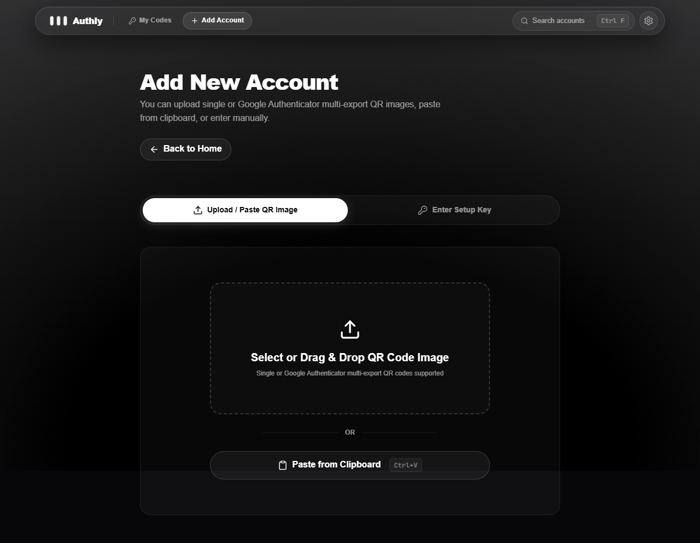
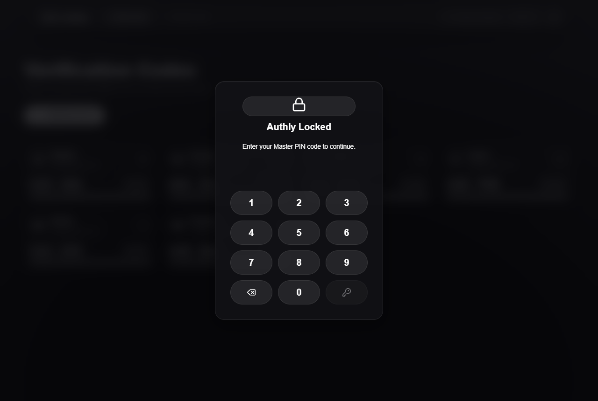
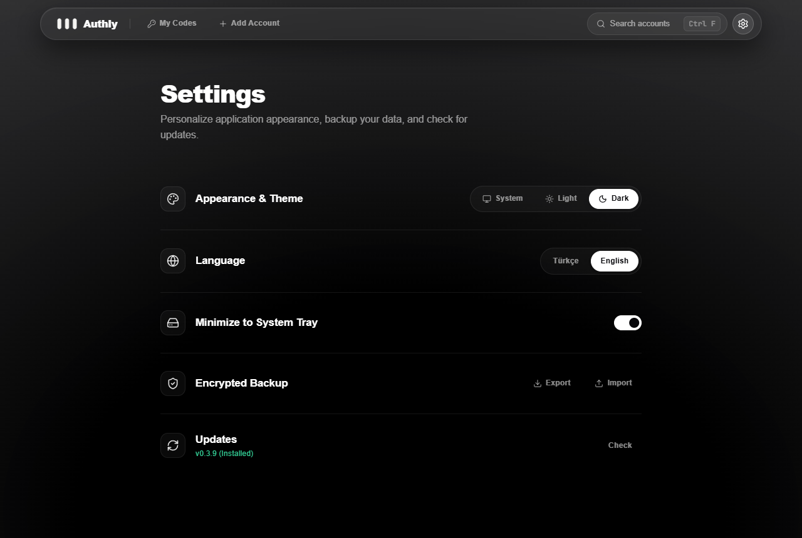

<p align="center"><strong>Türkçe</strong> · <a href="README.md" lang="en">English</a></p>

<p align="center">
  
</p>

<div align="center">
  <h1>Authly</h1>
  <p><strong>Kodların. Kendi cihazında.</strong></p>
  <p>Windows ve Linux için çevrimdışı masaüstü doğrulayıcı.<br>Bulut hesabına ihtiyaç duymadan, doğrulama kodlarını kendi cihazında üret.</p>
  <p><code>Windows</code> &nbsp; <code>Linux</code> &nbsp; <code>TOTP</code> &nbsp; <code>MIT</code></p>
  <p>
    <a href="https://github.com/ardakrt/authly/releases/latest">İndir</a> ·
    <a href="#yakından-bak">Ekran görüntüleri</a> ·
    <a href="#günlük-girişler-için">Özellikler</a> ·
    <a href=".github/readme/DEVELOPMENT.md">Kaynaktan derle (İngilizce)</a>
  </p>
</div>

---

## Doğrulama kodların elinin altında

Authly, zamana dayalı doğrulama kodlarını tek bir masaüstü uygulamasında toplar. Hesabını ekle, kodunu bul ve ihtiyacın olduğunda kopyala. TOTP kodları cihazında üretilir; hesapların gizli anahtarları, işletim sisteminin şifreleme olanaklarıyla yerel olarak saklanır.

1. **Hesabını ekle.** Gizli anahtarını gir, bir `otpauth://` bağlantısı yapıştır veya QR görseli içe aktar.
2. **Kodunu al.** Güncel kodu ve kalan süreyi gör; tek tıkla kopyala.
3. **Kurtarma kopyanı sakla.** Cihaz değiştirmeden önce parola ile şifrelenmiş bir yedek dışa aktar.

## Yakından bak

### Okunaklı kodlar. Açık veya koyu.

Sade hesap kartları, canlı geri sayım ve kompakt gezinme çubuğu. Açık, koyu veya sistem görünümünü seç; arayüzü Türkçe ya da İngilizce kullan.

<picture>
  <source media="(prefers-color-scheme: dark)" srcset=".github/readme/images/accounts-dark.png">
  <source media="(prefers-color-scheme: light)" srcset=".github/readme/images/accounts-light.png">
  
</picture>

<p align="center"><sub><a href=".github/readme/images/accounts-dark.png">Koyu görünüm</a> · <a href=".github/readme/images/accounts-light.png">Açık görünüm</a></sub></p>

### Hesabını ekle. Uygulamanı kilitle.

Elle giriş, doğrulayıcı bağlantıları ve QR görseli içe aktarma aynı hesap ekleme akışında buluşur. Ana PIN ile uygulamaya erişimi kilitleyebilirsin.

<p align="center">
  <a href=".github/readme/images/add-account.png"></a>
  <a href=".github/readme/images/pin-lock.png"></a>
</p>

<sub>Görseller, mevcut arayüzden örnek hesaplar ve sabit örnek kodlarla alınmıştır. Gerçek gizli anahtar veya kullanılabilir doğrulama kodu içermez; güvenlik denetimi niteliği taşımaz.</sub>

## Günlük girişler için

- **Çevrimdışı TOTP.** Ayarlanabilir algoritma, basamak sayısı ve süre ile RFC 6238 kod üretimi.
- **Hesap eklemenin farklı yolları.** Gizli anahtar girişi, `otpauth://` bağlantısı ayrıştırma ve QR görseli okuma.
- **Bul ve kopyala.** Hesap arama, hesap bilgilerini düzenleme ve tek tıkla kod kopyalama. Kopyalanan kod hâlâ panodaysa 15 saniye sonra temizlenir.
- **Yerel anahtar saklama.** Electron `safeStorage`, hesapların gizli anahtarlarını şifrelemek için Windows DPAPI veya kullanılabilir bir Linux anahtarlık altyapısını kullanır.
- **PIN ile erişim kilidi.** Ana PIN ve art arda başarısız denemelerden sonra uygulanan bekleme süresiyle uygulama arayüzünü koru.
- **Şifrelenmiş yedekler.** PBKDF2-SHA256 ve AES-256-GCM ile parola korumalı dışa ve içe aktarma.
- **Masaüstü tercihleri.** Sistem tepsisi davranışı, Türkçe/İngilizce dil seçimi ve açık/koyu/sistem görünümü.
- **Sürüm güncellemeleri.** GitHub sürümlerini kontrol et ve mevcut güncellemeleri kurulu uygulama içinden indir.

## Sana göre ayarla

Görünüm, dil, sistem tepsisi davranışı, şifrelenmiş yedekler ve güncelleme kontrolleri tek bir ayarlar ekranında.

<p align="center">
  <a href=".github/readme/images/settings.png"></a>
</p>

## Kurulum

**[Son sürümü indir →](https://github.com/ardakrt/authly/releases/latest)**

Sürüm dosyalarından Windows kurulum paketini indir. Linux AppImage ve Debian derleme hedefleri depoda bulunur; yayımlanmış paketler için sürüm dosyalarını kontrol et veya [derleme yönergelerini (İngilizce)](.github/readme/DEVELOPMENT.md#packaging) izle.

- **Windows:** Windows 10/11, x64.
- **Linux:** GNOME Keyring veya KWallet hizmeti kurulu ve kilidi açık bir x64 dağıtım.

Linux'ta Electron güvensiz `basic_text` yedek yöntemini seçerse Authly yeni gizli anahtarları saklamayı reddeder. Kullanılabilir ve kilidi açık bir işletim sistemi anahtarlığı gerekir.

## Verilerin cihazında

Hesap verileri ve şifrelenmiş gizli anahtarlar, Electron'un kullanıcıya özel uygulama verisi dizininde tutulur. Kod üretimi veya hesap yönetimi için bulut hesabı gerekmez. Cihazlar arasında kurtarma için ayrı bir parola ile şifrelenmiş yedek dosyası kullanılır.

<details>
<summary><strong>Saklama, şifreleme ve ağ davranışı</strong></summary>

- **Saklama:** SQLite veritabanı ve işletim sistemiyle şifrelenmiş gizli anahtarlar Windows'ta `%APPDATA%\authapp`, Linux'ta genellikle `~/.config/authapp` altında tutulur. Çalışma zamanı veritabanları ve kişisel yedekler Git'e eklenmemelidir.
- **Yedekler:** Mevcut dışa aktarma biçimi, PBKDF2-SHA256 ve 600.000 yineleme ile 256 bit anahtar türetir; ardından yedeği AES-256-GCM ile şifreler. Yedek parolasını yedek dosyasından ayrı sakla.
- **PIN'in kapsamı:** PIN, uygulamaya erişimi kilitler. Saklanan hesap anahtarlarını işletim sistemi tabanlı şifreleme korur; PIN, tüm kasayı ayrıca şifreleyen bağımsız bir anahtar değildir.
- **Süreç ayrımı:** Arayüz, doğrudan Node.js veya veritabanı erişimi yerine belirli ve doğrulanan IPC yöntemleri üzerinden hesap işlemlerine erişir.
- **Ağ:** TOTP kodları çevrimdışı üretilir. Güncelleme kontrolü ve indirmeler GitHub'a bağlanır. Mevcut arayüz stil dosyası Google Fonts'a da başvurur; yerel yazı tipi paketleri ve sistem yedekleri bulunur. Çevrimdışı çalışma, tüm arayüz ve güncelleme yollarının hiç ağ isteği yapmadığı anlamına gelmez.

Bunlar uygulama ayrıntılarıdır; bağımsız güvenlik sertifikası iddiası değildir.

</details>

## Geliştirme

**Electron · React · TypeScript · Vite · SQLite**

Node.js 20.19+ ve npm 11+ kurulu ortamda:

```bash
git clone https://github.com/ardakrt/authly.git
cd authly
npm ci
npm run dev
```

Projenin doğrulama sürecini çalıştır:

```bash
npm run verify
```

Bu komut biçimlendirme, lint, testler, sıkı TypeScript/derleme kontrolleri ve Electron çalışma zamanı temel kontrolünü çalıştırır. **[Geliştirme ve paketleme rehberi (İngilizce) →](.github/readme/DEVELOPMENT.md)**

## Lisans

[MIT](LICENSE). Atıf ve kullanım koşulları için lisans dosyasına bak.

---

<p align="center">
  <br>
  <sub><strong>Authly</strong> · Kodların. Kendi cihazında.</sub>
</p>
